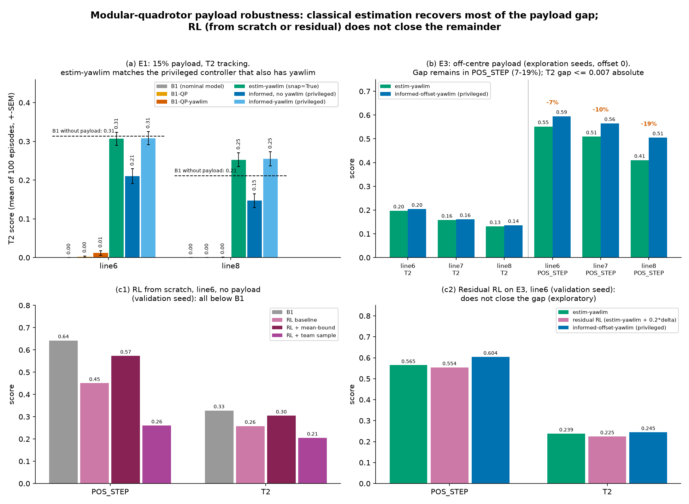
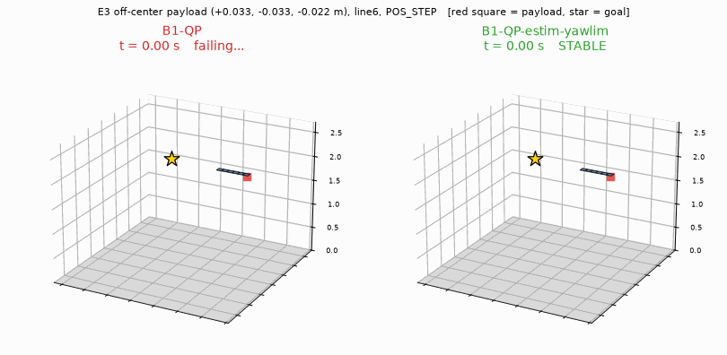

# 模組化對接多旋翼：未知 payload 下，古典控制器 vs 學習的控制器



圖說：(a) 虛線是沒有 yawlim 的 B1（無 payload）；有 yawlim 的標稱 B1-QP-yawlim 在 line8 為 0.378，所以 line8 的剩餘落差（0.253）是物理權限，不是資訊缺口。「informed」不含 yawlim，公平的特權對照是 informed-yawlim。(a) 的 estim-yawlim 資料來自 `g2_estim_raw.json`（snap=True 調參版本）；payload 掛模組中心時 snap=True/False 差 ≤0.002（`results/p2/p3d_factorial.md` 事實陳述 6：line8 T2 snap=True 0.253、snap=False 0.255；line6 皆 0.307）。(b) 為探索 seed（offset 0），每格 100 episode，無信賴區間；確認 seed（offset 900000）模式相同，POS_STEP estim/informed：line6 0.548/0.595、line7 0.498/0.559、line8 0.385/0.494（line8 缺口約 22%，確認 seed 數字見 `results/p2/classical_confirm.md` E3 節）。(c2) 為驗證 seed（offset 100），所以同一格 line6 POS_STEP estim 為 0.565，而 (b) 為 0.552，兩者 seed 不同。

**一句話**：多個小四旋翼模組實體對接成一個剛體、由一個大腦控制；在未知 payload（質量、重心偏移）下，古典分析（QP 推力分配、yaw 限速、線上估計）補掉了大部分缺口，手寫 PPO 當探針：從零訓練的 RL 在 line6 標稱條件下就沒追上古典基線，探索性的殘差 RL 也沒有補上剩下的缺口；負面結果照實報告。

**English summary.** Several small quadrotor modules are physically docked into one rigid body with a single centralized controller (no decentralization claim). The repo contains a from-scratch PPO (`ppo.py`), a from-scratch batched rigid-body simulator (`quadsim/`), and a CAD model of the module (`cad/`). The main question is how well classical vs. learned controllers cope with an unknown payload (mass and center-of-mass offset). Conclusions rest mainly on classical analysis; RL is used as a probe, and its negative results are reported. QP thrust allocation and a yaw-rate limiter close the shape-information and yaw-saturation gaps; an online estimator recovers most of the payload gap; a reset-on-event variant matches an event-informed oracle for mid-flight payload attach/drop. A residual gap remains for an off-center payload (POS_STEP). On line6, RL did not pass the pre-registered go/no-go within the two allowed recipe changes, so the RL main experiment was not run; an exploratory residual-RL run did not close the remaining gap. All numbers below are quoted from files in `results/`.

---

## 主要發現

所有數字皆為本 repo 內模擬結果，出處附在每條後面。分數定義見「方法摘要」。

1. **QP 推力分配修掉「形狀資訊」瓶頸。** 在理想通訊、構型已知的設定下，補上飽和處理（QP）之後，k 跳的形狀資訊不再是瓶頸（G1 v1：15 格中 4 格落後 ≥5 pp，最大 66.7 pp，中位數 0.3 pp；v2 之後剩下的落後來自飽和協調）。出處：`results/p2/g1.md`、`results/p2/g1_v2.md`、`results/p2/g1_v2_notes.md`。
2. **yawlim（yaw 參考限速）修掉 yaw 飽和。** 例：line8 T2 的 B1-QP 為 0.274（成功率 80%），B1-QP-yawlim 為 0.378（成功率 99%）。我們另外檢查過「yawlim 是不是拿 yaw 換位置」：line8 的 yaw RMS 由 1.046 降到 0.868 rad，疑點不成立。出處：`results/p2/g1_yawcost.md`（line8 兩列與事實陳述 1）、`results/p2/g1_coord.md`。以上是探索 seed；confirmatory seed 上為 0.328（87%）對 0.411（100%），結論相同（`results/p2/classical_confirm.md` NOM 節）。
3. **payload 是最傷的誤差，線上估計補回大部分缺口。**
   - 推力係數 ±20% 時最強古典法的分數只相對下降 1.7%，對接偏差 ±5mm、±2° 只下降 0.3%；payload 15% 時最強古典法相對標稱最強下降 15.0%，B1-QP 相對自己的標稱下降 90.4%（g2.md 欄名寫 pp，但定義是 100(1 − 誤差下分數／標稱分數)，是相對百分比）。出處：`results/p2/g2.md` 的 Q1 表。
   - payload 30% 在推重比 1.12 下連懸停都不可行（LP 驗證）。出處：同檔「物理可行性」表。
   - 線上估計 B1-QP-estim 在缺口 ≥5pp 的 11 格，補回比例平均 0.94、範圍 0.80–1.08（逐格 CI 見表）。出處：`results/p2/g2_estim.md` 的「彙總」表；informed（特權）參考見 `results/p2/g2_informed.md`。
4. **飛行中 payload 事件（RQ-D）：加上變點偵測重置的估計器接近事件特權參考。** estim-reset-yawlim 在 12 個「任務 × 條件」列中都是 informed-event-yawlim 的 0.98–1.00 倍；沒有重置的 estim-yawlim 在偏離中心時只有 0.66–0.89 倍。出處：`results/p2/rqd_classical.md`「事實陳述」第 2、3 條（探索 seed）。confirmatory seed 用同樣的四構型平均：estim-reset 0.98–1.00 倍；無重置偏離中心 0.67–0.89 倍（`results/p2/classical_confirm.md` EV 節）。
5. **剩下的缺口：偏心 payload（E3）的 POS_STEP。** 全開古典法（QP + yawlim + estim，snap=False）在 E3 仍落後知道偏移的 informed 參考；探索 seed 上 POS_STEP 的 estim / informed 為 line6 0.552 / 0.595、line7 0.509 / 0.565、line8 0.410 / 0.505（相對缺口約 7–19%，line8 最大）；confirmatory seed 上為 0.548 / 0.595、0.498 / 0.559、0.385 / 0.494（約 8 / 11 / 22%），成對差 informed−estim 為 +0.047、+0.061、+0.108，95% CI 都不含 0（`results/p2/classical_confirm.md` E3 節）。出處：`docs/prereg.md` 5.b 的表（探索 seed 的 estim / informed 分數，凍結版）；因子分解見 `results/p2/p3d_factorial.md`、`results/p2/p3d_resolve.md`。
6. **RL（標稱條件、無 payload）：單機可以，line6 不行。**
   - 單機（single）T1+T2 混訓，驗證 seed、每格 100 episode：ATT_STEP / POS_STEP / T2 為 max(B1, B1-QP) 的 1.046 / 1.054 / 1.099 倍，成功率 100%。出處：`results/p3/abl_single_mix_k1_h4/eval_val.json`、`results/p3/STATUS.md`「#81」。
   - line6 在 prereg 規定的配方修改預算內都沒有學起來（見下一節），依 prereg 7.3，RL 主實驗不開。
**古典結果的 confirmatory 確認（prereg §14(a)，凍結後執行）。** E1、E2、E3、標稱與 RQ-D 共 384 格，在 confirmatory seed（offset 900000）上重算，參數不重調，結果見 `results/p2/classical_confirm.md`。
- 結論方向都和探索 seed 相同。機械規則標成「方向不一致」的 9 列，兩邊的差都在 ±0.015 內（confirmatory 差 ≤ 0.006），沒有任何結論翻轉：4 列的 CI 含 0，2 列下界剛好是 0，另外 3 列（RQ-D 的 estim-reset 對 informed-event）是 +0.002 到 +0.003 的小差，CI 不含 0，方向是 informed 略好，和「estim-reset 為 informed-event 的 0.98–1.00 倍」一致。
- E3 的 12 個分任務分數與 prereg 5.b 先填入的值相差都 < 0.002。
- T2 的絕對分數在 confirmatory seed 上普遍高約 0.02–0.05，POS_STEP 幾乎不變。比值與缺口的結論不受影響。
- 第 3 點的 g2 Q1 表與補回比例 0.94 是探索 seed 的數字，沒有用同樣的形式重算。

7. **探索性殘差 RL（prereg 第 13 節，不作判定）：沒有補到缺口。** 驗證 seed 上 E3 POS_STEP：殘差 RL 0.554、estim-yawlim 0.565、informed 0.604；成對差 RL−estim 為 −0.010 [−0.013, −0.008]；另一個訓練 seed（seed 8）重跑得 0.555、−0.010 [−0.011, −0.009]，兩個 seed 各格分數差 ≤ 0.002（兩次都在 120 分鐘上限停在約 3.3e7 步）。出處：`results/p3/STATUS.md`「探索性殘差 RL」「seed 8 補跑」兩節。標稱條件下殘差 RL 的 T2 是 B1 的 1.27 倍，但該輪評估沒有列出標稱下的 estim-yawlim，**不能歸功於殘差**，本 README 不作此宣稱。

---

## 方法摘要

**模擬器**（`quadsim/`，規格 `docs/env_spec.md`）：手寫批次剛體模擬，物理 dt = 0.002 s、控制 100 Hz；一階馬達延遲、陀螺儀與加速度計雜訊；半隱式 Euler 加四元數姿態。模組參數的 CAD 來源在 `cad/`。payload 在 env 中是掛在模組中心（或固定偏移）的質點。

**任務**（`docs/env_spec.md`、`scripts/g1_gate.py`）：
- T1：隨機初始姿態（roll、pitch 在 ±60° 內）與速度，回到原點懸停。
- T2：設定點跟蹤，每 1.5 s 換目標（位置 ±1 m 內、yaw ±90° 內）。
- ATT_STEP：姿態階躍，以姿態 RMS 計分（e_ref = 1.0 rad）。
- POS_STEP：位置階躍，以位置 RMS 計分（e_ref = 1.5 m）。

**計分**：`score = success × max(0, 1 − e_rms / e_ref)`（`scripts/g1_gate.py` 檔頭）。ATT_STEP 用姿態誤差，POS_STEP 與 T2 用位置誤差；1 為完美，0 為失敗或完全沒修正。

**控制器家族**（`quadsim/controllers.py`）：
- B1：集中式基線；B1-QP：加 QP 推力分配。
- yawlim：加 yaw 參考限速（參數在 TRAIN 構型上 20 組搜尋）。
- estim：線上估計總質量與重心偏移（RLS，只用帶雜訊的陀螺儀、加速度計與自己送出的馬達指令，描述見 `results/p2/g2_estim.md`）；`snap=False` 為主設定（見下方揭露）；estim-reset 另加變點偵測重置。
- informed：特權參考，直接用含 payload 的真實模型；只當參考上限。
- 對照：B3 INDI、B3+adapt。

**RL 設定**：手寫 PPO（`ppo.py`，介面見 `docs/ppo_interface.md`）；多模組策略 `quadsim/policy.py`（GNN、k 跳資訊、H 步歷史；actor 看不到 payload，critic 有特權欄位）。RL 評估一律用驗證 seed（offset 100），不碰 confirmatory seed。訓練腳本 `scripts/rl_train.py`，評估 `scripts/rl_eval.py`。

**預註冊與事後揭露**（`docs/prereg.md`，v1.0 已凍結，tag `prereg-v1.0`；凍結後的項目與勘誤見 §11、§14）：
- `snap=False` 作為主設定，是**看過偏離中心的古典診斷結果之後**才選的（選擇時沒有 RL 評估參與）。
- E3 這一格是**看過古典缺口分解之後**才選的（同樣在任何 RL 評估之前）。
- E3 的主檢定任務在 v0.4 由 T2 改成 POS_STEP：依預先寫好的規則（探索 seed 上古典 estim 與 informed 的平均相對缺口最大者），套用結果為 POS_STEP；v0.3 原選 T2 是依 T2+POS 合併值。
- 凍結之後的任何改動都會列為「偏離預先登記」。

---

## 什麼沒成功

1. **`snap=True` 在偏心 payload 下失敗。** snap=True 把重心估計吸附到最近的模組中心，等於假設 payload 掛在模組中心；payload 掛中心時與 snap=False 幾乎相同（payload15 line8 T2：snap=True 0.253、snap=False 0.255，見 `p3d_factorial` 主分析與 snap=False 重跑兩張表），偏離中心時 line6 / line8 T2 的 QP+yawlim+estim 為 0.000 對 snap=False 的 0.197 / 0.131（成功率 0% 對 74%、58%）。調參時選中了 snap=True（調參與正式評估的掛點都在模組中心，沒測偏離中心）。出處：`results/p2/p3d_factorial.md` 事實陳述 6、`results/p2/g2_estim.md` 末段「調參」。
2. **RL line6 三個配方都沒過 go/no-go**（驗證 seed、每格 100 episode，分數比值為 RL / B1；出處 `results/p3/STATUS.md` 對應各節）：

   | 配方 | 結果 |
   |---|---|
   | #82 原版（line6 標稱） | ATT 0.61、POS 0.70、T2 0.79；訓練成功率逐步下降（T2 0.61 到 0.45，T1 0.55 到 0.36） |
   | 配方修改 1：動作均值超界懲罰（4e7 步） | T2 0.929、POS 0.892、ATT 0.491（seed 8 重跑：T2 0.661、POS 0.707、ATT 0.634，仍未過）；飽和降到與 B1 同水準，但整體沒有一致變好，判定飽和是症狀。該 run 學習率在 4e7 步內退火到 0，與原版 1.5e8 步不是同條件比較 |
   | 配方修改 2：整隊一筆樣本（1.5e8 步） | ATT 0.759、POS 0.405、T2 0.626；配方修改預算（2 次）用完 |

   診斷：原版 RL 的動作飽和比例 0.490，B1 為 0.149、B1-QP 為 0.170；失敗型態是傾角翻覆；policy 沒有崩壞、value 正常、雜訊不是原因（診斷數字出處見 `results/p3/STATUS.md`）。依 prereg 7.3，RL 主實驗不開。
3. **探索性殘差 RL**：見主要發現第 7 條；在該預算下學到的是接近 0、略有傷害的修正（E3 POS_STEP −0.010，CI 不含 0），不再追加 RL 實驗。
4. **Hopper 驗收條件是看過結果後修改的。** 原條件「我們的 3 個 seed 都落在 CleanRL 範圍內」依該條件判定為未通過，之後才改為「平均差的 95% bootstrap CI 落在 ±15% 內」；8 seed 時 CI 為 [−14.2%, +15.1%]，邊緣未過；之後序貫延伸到 12 seed（看到 seed 9–12 之前宣告），平均 ours 2275.3、CleanRL 2268.1，相對差 +0.3%，CI [−10.8%, +11.6%]，通過。區間由 `scripts/hopper_ci.py` 重算，結果在 `results/p1/hopper_ci.json`；2026-11-04 前的版本寫 [−14.4%, +15.2%] 和 [−10.1%, +12.3%]，原計算沒留下腳本，重算後判定不變。這是序列檢定，名目 α 略膨脹。出處：每個 seed 的最後 10 萬步平均 return 可由原始曲線重算（`scripts/compare_hopper.py`）；原始曲線 `results/p1/hopper_*_seed*.csv`、`results/p1/hopper_compare.png`。
5. **train4 多構型混訓卡在平台。** single / line2 / line3 / square4 混訓 3e8 步，12 格中 4 格 < 0.90 倍 B1（line2／line3／square4 的 T2、line3 的 ATT_STEP；prereg 7.3 原寫 6 格，已在修訂紀錄勘誤）；T2 成功率只有 63–87%（B1 為 99%）（以上為探索 seed 的數字）；訓練中 7.5e7 到 3e8 步停在平台，不是步數不足。k/H 消融（單機 k=1、H=4 達 1.05–1.10 倍）顯示問題在多構型共用訓練，不在 k/H。多構型修正未做。出處：`results/p3/STATUS.md`「train4_mix_k1_h4 評估結果」「#81」、`results/p3/train4_mix_k1_h4/eval_final.json`。

---

## 基線失敗案例影片（古典 B1-QP，不是 RL）



E3 偏心 payload（15%，偏移 (+0.033, −0.033, −0.022) m）、line6、POS_STEP，同一個 episode（取「B1-QP 失敗且 estim 存活」的第一個）。這支影片展示的是估計器補上的那一半缺口（沒有估計的古典基線墜毀），不是 RL 的失敗，也不是 estim 與 informed 之間剩下的 7–19%。左：B1-QP 在 t = 0.96 s 偏離目標超過 3 m 被判定終止（這個情境下 100 個 episode 全數失敗）。右：B1-QP-estim-yawlim 穩定抵達目標（100/100 存活）。動畫用專案自己的剛體模擬器重跑後以 matplotlib 繪製，重新產生：`PYTHONPATH=. python scripts/render_failure.py [--ep N]`。

---

## 重現

```bash
bash scripts/reproduce.sh          # 快速模式：從已存的 json 重畫圖表（圖 (b) 的六個數字取自 `docs/prereg.md` 5.b 的表，不由 json 重算）
bash scripts/reproduce.sh --full   # 重跑古典實驗，需數小時
```

加 `--dry-run` 只印出指令不執行。圖 (a)(c1)(c2) 從已存 json 讀取；圖 (b) 的 6 個數字是 `make_figures.py` 內的常數，抄自 `docs/prereg.md` 5.b 的探索 seed 表（對應 E3 腳本輸出未存成 json），`--full` 之後 (b) 仍用舊常數。RL 結果需要 GPU 訓練出的 checkpoint，`reproduce.sh` 不重跑 RL，圖直接讀已存的評估 json。

環境（CPU 環境的固定版本見根目錄 `requirements.txt`，由 `.venv` 產生；其中 `torch==…+cpu` 需用 PyTorch 的 CPU index 安裝，例如 `pip install -r requirements.txt --extra-index-url https://download.pytorch.org/whl/cpu`）：
- `.venv`：CPU 版 torch，加上 cadquery、mujoco、gymnasium、tyro；CAD 測試要用這個環境。
- `.venv-gpu`：torch 2.11 cu128，給 RL 訓練用（此環境沒裝 cadquery，`test_cad` 會被跳過）。

RL 訓練與評估是普通的 python 指令，例如：

```bash
.venv-gpu/bin/python -m scripts.rl_train ...   # 參數見各 run 的 results/p3/<run>/args.json
.venv-gpu/bin/python -m scripts.rl_eval results/p3/abl_single_mix_k1_h4/final.pt --configs single --tasks ATT_STEP POS_STEP T2
```

單元測試：`.venv/bin/python -m pytest -q tests/`（個別檔案見 `tests/`）。

---

## Repo 結構

| 路徑 | 內容 |
|---|---|
| `ppo.py` | 手寫 PPO（介面 `docs/ppo_interface.md`） |
| `quadsim/` | 批次剛體模擬（`env.py`）、組裝（`assembly.py`）、控制器（`controllers.py`）、策略（`policy.py`）、RL 環境包裝（`rl_env.py`）、整隊 PPO（`team_ppo.py`） |
| `cad/` | 模組 CAD（CadQuery），說明 `cad/README.md` |
| `scripts/` | 實驗腳本（g1/g2/p3d/rqd 古典實驗、`rl_train.py`、`rl_eval.py`、Hopper 對照） |
| `analysis/` | 早期可行性分析（可控性、可辨識性、接頭負載等） |
| `results/p0` `p1` `p2` `p3` | 各階段結果：p1 為 Hopper / Pendulum 對照 CleanRL、p2 為古典實驗、p3 為 RL |
| `docs/` | `prereg.md`、`env_spec.md` 等 |
| `third_party/cleanrl` | Hopper 驗收對照用 |
| `LICENSE` | MIT 授權（`third_party/cleanrl/LICENSE` 為 CleanRL 的授權） |
| `requirements.txt` | CPU 環境的固定相依版本 |

## AI assistance and internal logs

The code, experiment scripts and paper draft in this repository were written by an AI assistant (Claude, Anthropic) under the author's direction; the author reviewed the work and decided the research direction and all trade-offs. In `docs/prereg.md`, "指揮官 (commander)", "白方 (white team)" and "使用者 (user)" are role names in this review process (the commander plans and verifies, the white team is an independent reviewer, the user is the author). The internal working logs that `docs/prereg.md` cites (`PROGRESS.md`, `PLAN.md` and similar) are not published because they contain private context. `docs/prereg.md` itself is published exactly as frozen (tag `prereg-v1.0`) to preserve the evidence of the freeze.

## 限制

- 全部是模擬，沒有實機；payload 是質點，非質點、柔性、真實磁鐵接頭行為不在模型內。「補回」一詞只在本 env 的 payload 模型內成立。
- 單一大腦（集中式控制），不主張去中心化；通訊理想。
- 估計器與 env 共用同一個 payload 模型（質點），這種循環只能靠偏離中心與 snap=False 條件部分檢驗。
- 資訊不對稱：古典法回授用真實狀態，estim 的估計只用帶雜訊感測器；INDI 用加速度計，與其他方法有資訊差。
- 評估集固定（固定 seed、每格 100 episode）；古典結果的區間只涵蓋抽樣變異，不涵蓋評估集本身的選擇。RL 配方大多只訓練 1 個 seed（line6 系列 seed 7；single 消融與 train4 seed 0）；殘差 RL 與 mean-bound 配方另補了 seed 8（探索性）。殘差 RL 兩個 seed 幾乎相同；mean-bound 兩個 seed 各任務的高低不同（T2 0.929 對 0.661 × B1），表示從頭訓練的跨 seed 變異很大。RL 結果是探針，不做跨 seed 推論；「line6 沒有學起來」是這些配方、這個 seed 下的觀察，不是對 RL 能力的一般性結論。
- 古典控制器的增益與超參數在特定構型與 payload 條件下調出（例如 yawlim 在 TRAIN 構型、estim 在驗證 seed），對 RL 偏嚴，但不代表在這些條件之外最佳。
- 結論限定為「相對於狀態回授的古典法」；RL 主實驗未開，所以**沒有**「RL 優於 / 劣於古典法」的判定性結論，只有 line6 配方未過 go/no-go 與探索性殘差 RL 的描述。
- 剩餘缺口：line8 payload15 T2 的剩餘落差（estim+yawlim 0.253（g2_estim，snap=True）對標稱 0.378）比資訊缺口大，屬物理權限問題（`results/p2/g2_estim.md`、`docs/prereg.md` 第 2 節）。
