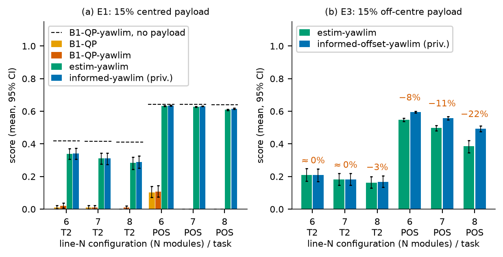
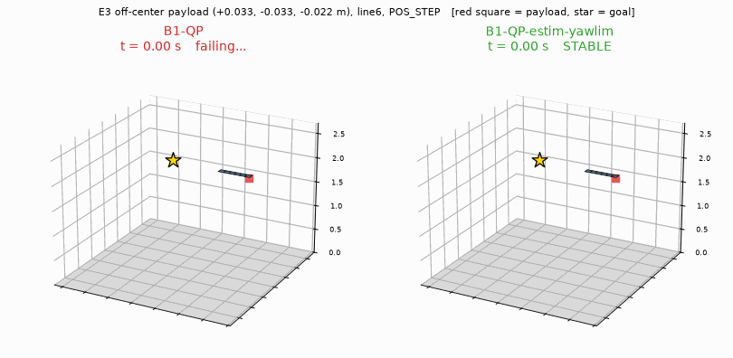
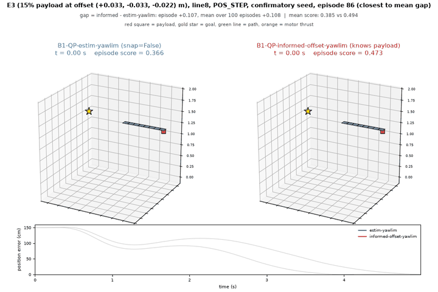
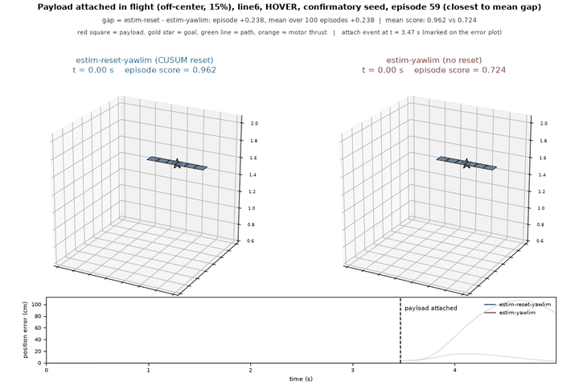
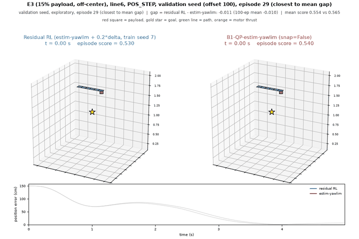
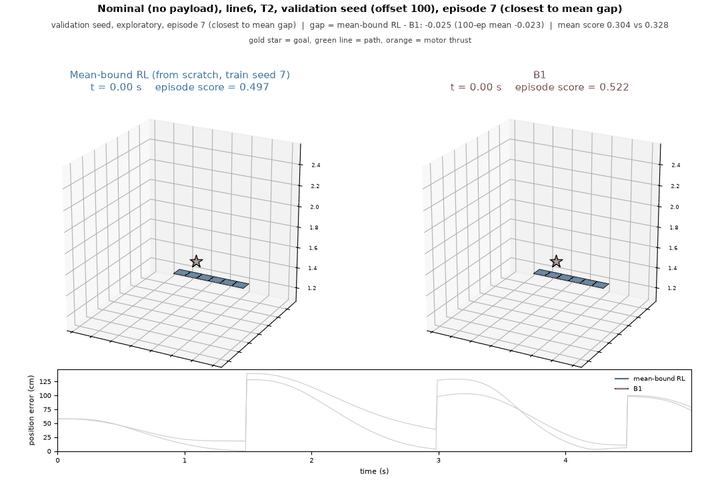

# 線上 payload 估計幾乎補上置中情況的缺口，但補不上偏心情況：對接式模組化多旋翼

[English](README.md) | [論文 PDF](paper/main.pdf) | [詳細中文專案筆記](docs/notes_zh.md)

（論文英文標題：Online Payload Estimation Nearly Closes the Centered Case but Not the Off-Center One in Docked Modular Multirotors）

幾台小四旋翼模組對接成一個剛體，由單一集中式控制器飛行，所載 payload 未知（質量與重心偏移）。我們在自製的批次剛體模擬器中研究這個問題，以古典控制為主：QP 推力分配、yaw 限速、遞迴最小平方的 payload 估計。從零手寫的 PPO 只當探索性的探針。研究有預先註冊（`docs/prereg.md`），古典結果另在保留的 confirmatory seed 上重算。

## 主要結果

- payload 是三種誤差中代價最大的。在探索 seed 上，15% payload 讓最強古典基線損失自身標稱分數的 14.4%，推力係數 +/-20% 誤差為 1.7%，對接誤差為 0.3%。
- payload 置中時，估計器 stack 與知道 payload 的參考之間，成對差最多 0.007（confirmatory seed）。
- payload 偏心時，位置階躍任務仍有 8/11/22% 的缺口（6/7/8 個模組）。
- 從零訓練的 PPO 沒有達到預先註冊的 RL 主實驗前置條件；在估計器 stack 上加的探索性殘差 PPO，兩個訓練 seed 都沒補上缺口。

完整的方法、統計與限制請見論文。



## 影片

下面的動畫直接在頁面上播放，點一下可看高解析度 MP4。全部由專案自己的模擬器渲染。後四支對照影片放的是 100 個 episode 中最接近平均差距的那一個；第一支放的是 B1-QP 墜毀的一個 episode。說明見 [results/media/README.md](results/media/README.md)。

**line6、偏心 payload、位置階躍。B1-QP 墜毀，估計器 stack 穩定飛行。**

[](results/media/failure.mp4)

**line8 剩下的偏心缺口，估計器 stack 對 informed 參考。**

[](results/media/e3_gap_line8.mp4)

**line6 飛行中掛上 payload，有無事件重置的對照。**

[](results/media/attach_event_line6.mp4)

**殘差 RL 對 estim-yawlim，line6，E3 位置階躍。**

[](results/media/rl_residual_line6.mp4)

**從零訓練的 mean-bound RL 對 B1，line6，無 payload，T2。**

[](results/media/rl_meanbound_line6.mp4)

## 快速開始

```bash
python3 -m venv .venv
.venv/bin/pip install -r requirements.txt --extra-index-url https://download.pytorch.org/whl/cpu
.venv/bin/python -m pytest -q tests/
bash scripts/reproduce.sh          # 快速：從已存的 json 重畫圖表
bash scripts/reproduce.sh --full   # 重跑古典實驗，需數小時
```

`requirements.txt` 固定 CPU 環境（`.venv`：CPU 版 torch、cadquery、mujoco、gymnasium、tyro）。RL 訓練用另一個 `.venv-gpu`（CUDA 版 torch 2.11 cu128），沒裝 cadquery，所以 `test_cad` 會被跳過。`reproduce.sh` 不重跑 RL，圖直接讀已存的評估 json。

```bash
.venv-gpu/bin/python -m scripts.rl_train --run-name t2_single --configs single:T2 --n-envs 2048 --total-steps 40000000 --device cuda
.venv-gpu/bin/python -m scripts.rl_eval results/p3/abl_single_mix_k1_h4/final.pt --configs single --tasks ATT_STEP POS_STEP T2
```

## Repo 結構

| 路徑 | 內容 |
|---|---|
| `quadsim/` | 批次剛體模擬器、組裝、控制器、策略、RL 環境包裝 |
| `ppo.py` | 手寫 PPO（介面見 `docs/ppo_interface.md`） |
| `scripts/` | 實驗腳本、`reproduce.sh`、`rl_train.py`、`rl_eval.py`、影片渲染 |
| `tests/` | 單元測試 |
| `cad/` | 模組的 CadQuery 模型 |
| `paper/` | LaTeX 原稿、圖、編譯好的 `main.pdf` |
| `results/` | 已存結果：`p1` Hopper 對照、`p2` 古典、`p3` RL、`media` 影片 |
| `docs/prereg.md` | 已凍結的預先註冊（tag `prereg-v1.0`） |
| `docs/notes_zh.md` | 詳細的中文專案筆記 |
| `third_party/` | CleanRL，用於 Hopper 驗收對照 |

## AI 協助說明

本 repo 的程式、實驗腳本與論文草稿由 AI 助理（Claude, Anthropic）在作者指示下撰寫；作者審閱成果，並決定研究方向與所有取捨。`docs/prereg.md` 中的「指揮官」「白方」「使用者」是審查流程的角色名：指揮官負責規劃與驗證，白方是獨立審查者，使用者即作者。`docs/prereg.md` 引用的內部工作紀錄含私人內容，未公開。`docs/prereg.md` 本身按凍結時的原樣公開。

## 授權

MIT，見 `LICENSE`。`third_party/cleanrl` 同為 MIT。

## 引用

```bibtex
@misc{ho2026docked,
  author = {Ho, Hao-Ting},
  title  = {Online Payload Estimation Nearly Closes the Centered Case but Not the Off-Center One in Docked Modular Multirotors},
  year   = {2026},
  note   = {Preprint},
  url    = {https://github.com/Jadiouo/docked-multirotor-payload}
}
```
