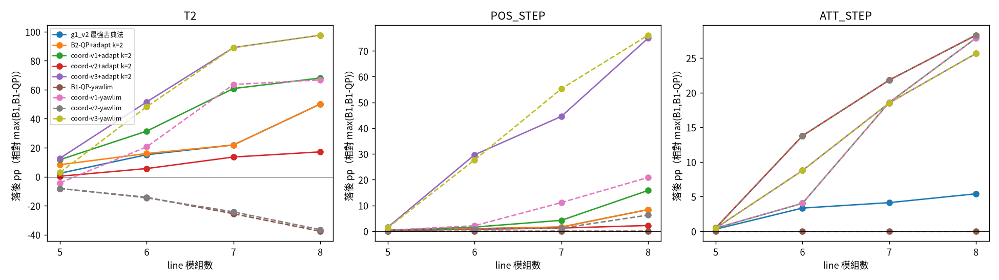

# G1 coord：協調飽和的古典法（B2-QP-coord）能補回多少缺口

由 `scripts/g1_coord.py` 產生（原始資料 `g1_coord_raw.json`；g1_v2 的方法直接讀 `g1_v2_raw.json`，沒有重跑）。每格 100 個 episode、同 seed、成對比較，標稱環境；分母 = 每格 max(B1, B1-QP)；落後 pp = 100(1 − 方法平均分數/分母平均分數)。

## 事先規定（在看到結果之前定下來）

協調機制：各模組照 B2-QP 解出自己 k 跳球內的分配，回報 4 個純量（Fz、roll、pitch、yaw 各自「達成的 wrench / 要求的 wrench」，夾在 [0,1]）；leader 對所有模組取 min，得到 4 個純量縮放比，廣播給所有模組；各模組把要求乘上縮放比後重解。每個模組收到的資訊 = B2 原有的（f_acc、α_cmd、自己 k 跳球的形狀）+ 每回合 4 個純量；leader 收到每個模組 4 個純量。**不廣播形狀。**沒有飽和時縮放比 = 1，輸出等於 B2-QP（有測試）。

| 變體 | 縮放方式 | 回合數 | 廣播純量 |
|---|---|---|---|
| v1 | 每個軸（Fz、roll、pitch、yaw）各自一個全域縮放比 | 1 | 4 |
| v2 | 優先序：只縮 yaw；roll、pitch、Fz 任何一軸有模組達不到，就繼續縮 yaw（縮放比 = 所有模組、所有軸達成比的最小值），保 roll/pitch/Fz | 2 | 4 / 回合 |
| v3 | 保方向：roll、pitch、yaw 三個力矩共用同一個縮放比（維持力矩向量的方向，Fz 不縮），縮放比 = 所有模組的三軸最小達成比，連續縮放 | 2 | 4 / 回合（三個力矩分量相同） |

v3 是我自己設計的方案。「最好的一種」是看評估結果挑的，對古典法有利，沒有修正。

另一個古典對手 **B1-QP-yawlim**：B1-QP + yaw 參考速率限制（速率上限 = rate_c·√(α_yaw 權限)，權限由標稱形狀算，是依構型 yaw 權限的增益排程），並同時調 yaw_ratio。在 TRAIN 構型（single, line2, line3, square4, S4, L4）的 T2 上做 20 組隨機搜尋（每組 32 episodes），選到 rate_c = 0.56、yaw_ratio = 0.415（TRAIN T2 分數 0.4151；無限速基準 0.4049）。B2-QP-coord-*-yawlim 沿用同一組參數、不再另調（局部形狀 + 同樣的 yaw 限速）。

## 主表（落後 pp，越小越好；負值 = 比分母好）

欄位：「g1_v2 最強古典法」= B2+adapt、B2-QP(+adapt) × k=1,2 六個中該格最好者（沿用 g1_v2 的定義）；「最強 coord」= 12 個 coord 方法（3 變體 × k=1,2 × 有無 adapt）中該格最好者。

### 鑑別組

| 構型 | 任務 | 分母(分數/成功率) | B2-QP+adapt k=2 落後pp | g1_v2 最強古典法 落後pp | coord-v1+adapt k=2 落後pp | coord-v2+adapt k=2 落後pp | coord-v3+adapt k=2 落後pp | 最強 coord (k,adapt,變體) 落後pp | B1-QP-yawlim 落後pp | coord-v1-yawlim 落後pp | coord-v2-yawlim 落後pp | coord-v3-yawlim 落後pp |
|---|---|---|---|---|---|---|---|---|---|---|---|---|
| line5 | T2 | B1-QP 0.363 / 97% | 8.2 | 2.3 | 11.7 | 0.3 | 12.7 | 0.3 [-2.2, 2.1] (v2+adapt k=2) | -8.1 | -4.3 | -8.2 | 2.9 |
| line5 | POS_STEP | B1-QP 0.642 / 100% | 0.3 | -0.0 | 0.4 | 0.3 | 1.5 | -0.0 [-0.0, -0.0] (v1 k=2) | -0.0 | 0.4 | 0.3 | 1.3 |
| line5 | ATT_STEP | B1-QP 0.733 / 100% | 0.5 | 0.3 | 0.5 | 0.5 | 0.5 | 0.5 [0.2, 0.8] (v1+adapt k=2) | 0.0 | 0.5 | 0.5 | 0.5 |
| line6 | T2 | B1-QP 0.339 / 95% | 16.0 | 15.1 | 31.4 | 5.6 | 51.6 | 5.6 [2.5, 9.5] (v2+adapt k=2) | -14.3 | 20.6 | -14.6 | 48.3 |
| line6 | POS_STEP | B1-QP 0.642 / 100% | 1.0 | 1.0 | 1.6 | 0.8 | 29.7 | 0.8 [0.6, 0.9] (v2+adapt k=2) | 0.0 | 2.1 | 0.8 | 27.7 |
| line6 | ATT_STEP | B1-QP 0.723 / 100% | 13.8 | 3.4 | 4.0 | 13.8 | 8.8 | 4.0 [1.1, 8.0] (v1+adapt k=2) | 0.0 | 4.0 | 13.8 | 8.8 |
| line7 | T2 | B1-QP 0.305 / 88% | 21.9 | 21.9 | 60.8 | 13.6 | 89.1 | 8.6 [1.5, 15.7] (v2+adapt k=1) | -25.6 | 63.6 | -24.3 | 89.0 |
| line7 | POS_STEP | B1-QP 0.641 / 100% | 1.6 | 1.6 | 4.2 | 1.2 | 44.6 | 1.2 [1.0, 1.5] (v2+adapt k=2) | 0.0 | 11.1 | 1.2 | 55.3 |
| line7 | ATT_STEP | B1-QP 0.719 / 100% | 21.8 | 4.1 | 18.6 | 21.8 | 18.5 | 18.5 [11.4, 25.7] (v3+adapt k=2) | 0.0 | 18.6 | 21.8 | 18.5 |
| line8 | T2 | B1-QP 0.274 / 80% | 50.1 | 50.1 | 68.1 | 17.1 | 97.6 | 17.1 [8.6, 25.4] (v2+adapt k=2) | -37.7 | 66.7 | -36.5 | 97.6 |
| line8 | POS_STEP | B1-QP 0.640 / 100% | 8.4 | 8.4 | 15.8 | 2.2 | 74.9 | 2.2 [1.7, 2.8] (v2+adapt k=2) | 0.0 | 20.9 | 6.2 | 76.1 |
| line8 | ATT_STEP | B1-QP 0.678 / 95% | 28.3 | 5.4 | 27.9 | 28.3 | 25.7 | 25.7 [18.1, 34.3] (v3+adapt k=2) | 0.0 | 27.9 | 28.3 | 25.7 |
| grid10 | T2 | B1-QP 0.363 / 98% | 5.5 | 5.5 | 12.2 | 1.9 | 24.0 | 1.9 [0.5, 3.3] (v2+adapt k=2) | -8.3 | -2.3 | -8.6 | 18.9 |
| grid10 | POS_STEP | B1-QP 0.642 / 100% | 0.8 | 0.0 | 0.8 | 0.7 | 9.9 | 0.0 [0.0, 0.0] (v1 k=2) | -0.0 | 0.8 | 0.7 | 8.7 |
| grid10 | ATT_STEP | B1-QP 0.725 / 100% | 8.0 | 0.5 | 6.1 | 8.0 | 6.2 | 6.1 [2.5, 10.6] (v1+adapt k=2) | 0.0 | 6.1 | 8.0 | 6.2 |

### 陰性對照組

| 構型 | 任務 | 分母(分數/成功率) | B2-QP+adapt k=2 落後pp | g1_v2 最強古典法 落後pp | coord-v1+adapt k=2 落後pp | coord-v2+adapt k=2 落後pp | coord-v3+adapt k=2 落後pp | 最強 coord (k,adapt,變體) 落後pp | B1-QP-yawlim 落後pp | coord-v1-yawlim 落後pp | coord-v2-yawlim 落後pp | coord-v3-yawlim 落後pp |
|---|---|---|---|---|---|---|---|---|---|---|---|---|
| grid9 | T2 | B1-QP 0.381 / 99% | 1.6 | -0.2 | 1.8 | -0.6 | 2.1 | -0.6 [-0.8, -0.4] (v2+adapt k=2) | -3.8 | -3.3 | -4.0 | 1.4 |
| grid9 | POS_STEP | B1-QP 0.645 / 100% | 0.2 | 0.0 | 0.2 | 0.2 | 0.2 | 0.0 [0.0, 0.0] (v1 k=2) | -0.0 | 0.2 | 0.2 | 0.2 |
| grid9 | ATT_STEP | B1-QP 0.733 / 100% | -0.1 | -0.1 | -0.1 | -0.1 | -0.1 | -0.1 [-0.3, 0.0] (v1+adapt k=2) | 0.0 | -0.1 | -0.1 | -0.1 |
| plus5 | T2 | B1-QP 0.385 / 99% | 0.0 | -0.1 | 0.0 | -0.5 | 0.7 | -0.6 [-0.7, -0.4] (v2 k=1) | -2.7 | -2.7 | -2.9 | -2.5 |
| plus5 | POS_STEP | B1-QP 0.645 / 100% | -0.0 | -0.0 | -0.0 | -0.0 | -0.0 | -0.0 [-0.0, 0.0] (v2+adapt k=1) | -0.0 | -0.0 | -0.0 | 0.0 |
| plus5 | ATT_STEP | B1-QP 0.726 / 100% | 0.0 | 0.0 | 0.0 | 0.0 | 0.0 | 0.0 [0.0, 0.0] (v1 k=1) | 0.0 | 0.0 | 0.0 | 0.0 |

## B2-QP-coord 補回了 g1_v2 缺口的幾 %

補回 % = (g1_v2 最強古典法落後 − 方法落後) / g1_v2 最強古典法落後 × 100，只在 g1_v2 落後 ≥ 5 pp 的格計算（避免除以接近 0 的數）。「合併」= 這些格的落後 pp 總和算比例。

| 方法 | line6 T2 | line7 T2 | line8 T2 | line8 POS_STEP | line8 ATT_STEP | grid10 T2 | 合併補回 % | 鑑別組 T2 平均落後 pp |
|---|---|---|---|---|---|---|---|---|
| coord v1 (k=2,adapt) | -108% | -178% | -36% | -89% | -415% | -120% | **-103%** | 36.8 |
| coord v2 (k=2,adapt) | 63% | 38% | 66% | 74% | -423% | 66% | **36%** | 7.7 |
| coord v3 (k=2,adapt) | -241% | -307% | -95% | -794% | -374% | -334% | **-241%** | 55.0 |
| 最強 coord（逐格挑） | 63% | 61% | 66% | 74% | -374% | 66% | **43%** | 6.7 |
| B1-QP-yawlim | 194% | 217% | 175% | 100% | 100% | 250% | **181%** | -18.8 |
| coord-v1-yawlim | -36% | -191% | -33% | -149% | -415% | 142% | **-85%** | 28.9 |
| coord-v2-yawlim | 196% | 211% | 173% | 25% | -423% | 255% | **146%** | -18.4 |
| coord-v3-yawlim | -219% | -307% | -95% | -808% | -374% | -241% | **-234%** | 51.3 |

（對照：g1_v2 最強古典法在鑑別組 T2 平均落後 19.0 pp；B2-QP+adapt k=2 為 20.3 pp。）

## 剩下的缺口（每格取所有古典方法中最好者，含 yawlim）

| 構型 | 任務 | 最好的新方法 | 落後 pp [95% CI] | 對照：相對 max(分母, B1-QP-yawlim) 的落後 pp |
|---|---|---|---|---|
| line5 | T2 | coord-v2+adapt-yawlim k=2 | -8.2 [-12.4, -5.2] | -0.0 |
| line5 | POS_STEP | coord-v1 k=2 | -0.0 [-0.0, -0.0] | -0.0 |
| line5 | ATT_STEP | B1-QP-yawlim | 0.0 [0.0, 0.0] | 0.0 |
| line6 | T2 | coord-v2+adapt-yawlim k=2 | -14.6 [-20.8, -9.6] | -0.3 |
| line6 | POS_STEP | B1-QP-yawlim | 0.0 [0.0, 0.0] | 0.0 |
| line6 | ATT_STEP | B1-QP-yawlim | 0.0 [0.0, 0.0] | 0.0 |
| line7 | T2 | B1-QP-yawlim | -25.6 [-37.0, -16.2] | 0.0 |
| line7 | POS_STEP | B1-QP-yawlim | 0.0 [0.0, 0.0] | 0.0 |
| line7 | ATT_STEP | B1-QP-yawlim | 0.0 [0.0, 0.0] | 0.0 |
| line8 | T2 | B1-QP-yawlim | -37.7 [-54.5, -25.6] | 0.0 |
| line8 | POS_STEP | B1-QP-yawlim | 0.0 [0.0, 0.0] | 0.0 |
| line8 | ATT_STEP | B1-QP-yawlim | 0.0 [0.0, 0.0] | 0.0 |
| grid10 | T2 | coord-v2+adapt-yawlim k=2 | -8.6 [-11.9, -5.8] | -0.2 |
| grid10 | POS_STEP | B1-QP-yawlim | -0.0 [-0.0, -0.0] | 0.0 |
| grid10 | ATT_STEP | B1-QP-yawlim | 0.0 [0.0, 0.0] | 0.0 |

## 缺口 vs 構型長度

（line5 → line8；實線 = 無 yaw 限速；虛線 = 含 yaw 限速。）

## 各方法 平均分數 / 成功率（新方法；g1_v2 方法見 g1_v2.md）

| 構型 | 任務 | B1-QP | c-v1 k=1 | c-v1 k=2 | c-v1+adapt k=1 | c-v1+adapt k=2 | c-v2 k=1 | c-v2 k=2 | c-v2+adapt k=1 | c-v2+adapt k=2 | c-v3 k=1 | c-v3 k=2 | c-v3+adapt k=1 | c-v3+adapt k=2 | B1-QP-yawlim | c-v1+adapt-yawlim k=2 | c-v2+adapt-yawlim k=2 | c-v3+adapt-yawlim k=2 |
|---|---|---|---|---|---|---|---|---|---|---|---|---|---|---|---|---|---|---|
| line5 | T2 | 0.363 | 0.296 / 88% | 0.353 / 95% | 0.259 / 78% | 0.321 / 90% | 0.295 / 88% | 0.354 / 95% | 0.335 / 93% | 0.362 / 97% | 0.273 / 81% | 0.350 / 95% | 0.081 / 24% | 0.317 / 86% | 0.393 / 99% | 0.379 / 97% | 0.393 / 99% | 0.353 / 90% |
| line5 | POS_STEP | 0.642 | 0.612 / 100% | 0.643 / 100% | 0.635 / 100% | 0.640 / 100% | 0.612 / 100% | 0.643 / 100% | 0.636 / 100% | 0.640 / 100% | 0.612 / 100% | 0.643 / 100% | 0.479 / 75% | 0.633 / 99% | 0.642 / 100% | 0.640 / 100% | 0.640 / 100% | 0.634 / 99% |
| line5 | ATT_STEP | 0.733 | 0.600 / 83% | 0.724 / 100% | 0.667 / 91% | 0.729 / 100% | 0.565 / 77% | 0.724 / 100% | 0.639 / 87% | 0.729 / 100% | 0.565 / 77% | 0.724 / 100% | 0.652 / 89% | 0.729 / 100% | 0.733 / 100% | 0.729 / 100% | 0.729 / 100% | 0.729 / 100% |
| line6 | T2 | 0.339 | 0.107 / 46% | 0.286 / 86% | 0.184 / 55% | 0.232 / 70% | 0.095 / 38% | 0.286 / 86% | 0.303 / 89% | 0.320 / 91% | 0.088 / 34% | 0.264 / 78% | 0.029 / 10% | 0.164 / 48% | 0.387 / 98% | 0.269 / 73% | 0.388 / 98% | 0.175 / 47% |
| line6 | POS_STEP | 0.642 | 0.181 / 64% | 0.627 / 100% | 0.628 / 100% | 0.631 / 100% | 0.169 / 56% | 0.627 / 100% | 0.633 / 100% | 0.637 / 100% | 0.158 / 56% | 0.627 / 100% | 0.280 / 44% | 0.451 / 72% | 0.642 / 100% | 0.628 / 100% | 0.636 / 100% | 0.464 / 73% |
| line6 | ATT_STEP | 0.723 | 0.405 / 53% | 0.596 / 83% | 0.564 / 77% | 0.694 / 96% | 0.432 / 59% | 0.572 / 79% | 0.539 / 72% | 0.624 / 85% | 0.432 / 59% | 0.572 / 79% | 0.599 / 82% | 0.660 / 91% | 0.723 / 100% | 0.694 / 96% | 0.624 / 85% | 0.660 / 91% |
| line7 | T2 | 0.305 | 0.012 / 6% | 0.172 / 55% | 0.134 / 41% | 0.120 / 38% | 0.012 / 6% | 0.165 / 51% | 0.279 / 80% | 0.264 / 79% | 0.011 / 4% | 0.132 / 43% | 0.003 / 1% | 0.033 / 10% | 0.383 / 98% | 0.111 / 34% | 0.379 / 98% | 0.034 / 11% |
| line7 | POS_STEP | 0.641 | 0.093 / 15% | 0.297 / 77% | 0.596 / 97% | 0.614 / 100% | 0.093 / 15% | 0.279 / 69% | 0.621 / 100% | 0.633 / 100% | 0.093 / 15% | 0.277 / 68% | 0.154 / 24% | 0.356 / 56% | 0.641 / 100% | 0.570 / 94% | 0.634 / 100% | 0.287 / 46% |
| line7 | ATT_STEP | 0.719 | 0.398 / 52% | 0.432 / 61% | 0.509 / 69% | 0.586 / 80% | 0.398 / 52% | 0.453 / 65% | 0.501 / 67% | 0.562 / 76% | 0.398 / 52% | 0.453 / 65% | 0.531 / 72% | 0.586 / 80% | 0.719 / 100% | 0.586 / 80% | 0.562 / 76% | 0.586 / 80% |
| line8 | T2 | 0.274 | 0.008 / 3% | 0.029 / 18% | 0.064 / 23% | 0.088 / 31% | 0.007 / 3% | 0.028 / 16% | 0.211 / 65% | 0.227 / 69% | 0.007 / 2% | 0.027 / 11% | 0.007 / 2% | 0.007 / 3% | 0.378 / 99% | 0.091 / 28% | 0.375 / 98% | 0.006 / 3% |
| line8 | POS_STEP | 0.640 | 0.054 / 9% | 0.174 / 40% | 0.519 / 88% | 0.539 / 91% | 0.054 / 9% | 0.174 / 27% | 0.584 / 97% | 0.626 / 100% | 0.054 / 9% | 0.174 / 27% | 0.137 / 22% | 0.161 / 25% | 0.640 / 100% | 0.507 / 85% | 0.600 / 99% | 0.153 / 24% |
| line8 | ATT_STEP | 0.678 | 0.371 / 48% | 0.371 / 48% | 0.429 / 57% | 0.489 / 66% | 0.371 / 48% | 0.371 / 48% | 0.389 / 51% | 0.486 / 65% | 0.371 / 48% | 0.371 / 48% | 0.419 / 57% | 0.504 / 68% | 0.678 / 95% | 0.489 / 66% | 0.486 / 65% | 0.504 / 68% |
| grid10 | T2 | 0.363 | 0.191 / 70% | 0.331 / 95% | 0.258 / 77% | 0.318 / 90% | 0.185 / 67% | 0.331 / 94% | 0.339 / 95% | 0.356 / 97% | 0.172 / 59% | 0.323 / 92% | 0.086 / 25% | 0.276 / 80% | 0.393 / 99% | 0.371 / 97% | 0.394 / 99% | 0.294 / 77% |
| grid10 | POS_STEP | 0.642 | 0.411 / 100% | 0.642 / 100% | 0.632 / 100% | 0.637 / 100% | 0.411 / 100% | 0.642 / 100% | 0.633 / 100% | 0.638 / 100% | 0.411 / 100% | 0.642 / 100% | 0.375 / 59% | 0.579 / 91% | 0.642 / 100% | 0.637 / 100% | 0.638 / 100% | 0.587 / 92% |
| grid10 | ATT_STEP | 0.725 | 0.441 / 66% | 0.624 / 87% | 0.566 / 78% | 0.681 / 94% | 0.441 / 66% | 0.612 / 85% | 0.560 / 77% | 0.667 / 92% | 0.441 / 66% | 0.612 / 85% | 0.566 / 78% | 0.680 / 94% | 0.725 / 100% | 0.681 / 94% | 0.667 / 92% | 0.680 / 94% |
| grid9 | T2 | 0.381 | 0.373 / 99% | 0.381 / 99% | 0.368 / 98% | 0.374 / 98% | 0.375 / 99% | 0.383 / 99% | 0.381 / 99% | 0.383 / 99% | 0.368 / 99% | 0.378 / 99% | 0.332 / 87% | 0.373 / 98% | 0.395 / 99% | 0.394 / 99% | 0.396 / 99% | 0.376 / 94% |
| grid9 | POS_STEP | 0.645 | 0.644 / 100% | 0.645 / 100% | 0.640 / 100% | 0.644 / 100% | 0.644 / 100% | 0.645 / 100% | 0.640 / 100% | 0.644 / 100% | 0.644 / 100% | 0.645 / 100% | 0.640 / 100% | 0.644 / 100% | 0.645 / 100% | 0.644 / 100% | 0.644 / 100% | 0.644 / 100% |
| grid9 | ATT_STEP | 0.733 | 0.712 / 100% | 0.728 / 100% | 0.712 / 100% | 0.734 / 100% | 0.712 / 100% | 0.728 / 100% | 0.712 / 100% | 0.734 / 100% | 0.712 / 100% | 0.728 / 100% | 0.712 / 100% | 0.734 / 100% | 0.733 / 100% | 0.734 / 100% | 0.734 / 100% | 0.734 / 100% |
| plus5 | T2 | 0.385 | 0.386 / 99% | 0.386 / 99% | 0.385 / 99% | 0.385 / 99% | 0.388 / 99% | 0.388 / 99% | 0.388 / 99% | 0.388 / 99% | 0.383 / 99% | 0.383 / 99% | 0.383 / 99% | 0.383 / 99% | 0.396 / 99% | 0.396 / 99% | 0.397 / 99% | 0.395 / 99% |
| plus5 | POS_STEP | 0.645 | 0.645 / 100% | 0.645 / 100% | 0.645 / 100% | 0.645 / 100% | 0.645 / 100% | 0.645 / 100% | 0.645 / 100% | 0.645 / 100% | 0.645 / 100% | 0.645 / 100% | 0.645 / 100% | 0.645 / 100% | 0.645 / 100% | 0.645 / 100% | 0.645 / 100% | 0.645 / 100% |
| plus5 | ATT_STEP | 0.726 | 0.726 / 100% | 0.726 / 100% | 0.726 / 100% | 0.726 / 100% | 0.726 / 100% | 0.726 / 100% | 0.726 / 100% | 0.726 / 100% | 0.726 / 100% | 0.726 / 100% | 0.726 / 100% | 0.726 / 100% | 0.726 / 100% | 0.726 / 100% | 0.726 / 100% | 0.726 / 100% |

## 事實陳述

（人工撰寫，數字取自上面各表與 `g1_coord_raw.json`、`g1_v2_raw.json`。）

1. **事先規定的三個變體裡，只有 v2（優先序，只縮 yaw）有用。** 鑑別組 T2 平均落後（相對 max(B1, B1-QP)）：g1_v2 最強古典法 19.0 pp → coord-v2+adapt k=2 為 7.7 pp，逐格挑最好的 coord 為 6.7 pp，即補回 g1_v2 T2 缺口的約 59–65%（line6/7/8/grid10 各格 38–66%）。v1（每軸縮放，含 Fz）比沒協調更差（平均 36.8 pp）；v3（保方向的三軸力矩共用縮放）最差（55.0 pp，line8 T2 成功率近 0）。原因推測：縮 Fz 或縮 roll/pitch 會讓高度或姿態失控；只縮 yaw 是 B1-QP 在飽和時本來的優先序，coord-v2 等於讓所有模組對「yaw 要放棄多少」取得共識。（推測，沒有另外驗證。）
2. **但這個缺口大部分是古典對手沒調好。** B1-QP-yawlim（B1-QP + yaw 參考速率限制，yaw 限速係數與 yaw_ratio 在 TRAIN 構型上做 20 組搜尋）在鑑別組 T2 的平均落後是 −18.8 pp，即**比 g1_v2 的分母 max(B1, B1-QP) 還好**（line8 T2 −37.7 pp [−54.5, −25.6]）。也就是 G1 v2 的「19 pp 缺口」有大半是 yaw 目標階躍加上沒調過的 yaw_ratio 造成的，不是古典法本身的極限。
3. **局部形狀 + yaw 限速 + coord-v2 追平完整形狀的 yawlim。** 以 max(B1, B1-QP, B1-QP-yawlim) 為分母，鑑別組 T2 上最好的局部方法（coord-v2+adapt-yawlim k=2）落後 −0.0、−0.3、1.0、0.8、−0.2 pp（line5–8、grid10）；對照 g1_v2 的最好局部方法落後 9.7、25.7、37.8、63.8、12.8 pp。本實驗沒有跑「B2-QP+adapt 只加 yawlim、不加 coord」，所以 coord 在 yawlim 之上的獨立貢獻無法從這組資料分離；只能說 coord-v2+yawlim 與 B1-QP-yawlim 的差距接近 0。
4. **POS_STEP 與 ATT_STEP。** POS_STEP：coord-v2 把 line8 從 8.4 pp 降到 2.2 pp，其餘 ≤ 1.6 pp。ATT_STEP：coord 沒有幫助，各 coord 方法都不比 B2+adapt（沒有 QP）好；剩下的缺口是 line6/7/8 的 3.4 / 4.1 / 5.4 pp（B2+adapt k=2），沒有任何本實驗的方法能補。yaw 限速對 ATT_STEP 沒有作用（B1-QP-yawlim = B1-QP）。
5. **剩下的缺口（相對含 yawlim 的分母，最好的局部方法）：** T2 約 0（最大 1.0 pp）；POS_STEP 最大 2.2 pp（line8）；ATT_STEP 最大 5.4 pp（line8）。陰性對照組沒有缺口。
6. **對 RL 的含意（事實，不是結論）：** 在 T2 這一條上，簡單的古典協調（4 個純量）加 yaw 限速已經沒有留下可見的飽和協調缺口，所以 RQ-A 的 A1 在 T2 上若要證明學習有利基，基準必須是 B1-QP-yawlim / coord-v2-yawlim，不是 g1_v2 的 max(B1, B1-QP)。ATT_STEP 的 3–5 pp 缺口、以及不知道 payload 的缺口（G2）不受本實驗影響。
7. **限制。** (a) 「最好的 coord」和「g1_v2 最強古典法」都是看評估結果逐格挑的，對古典法有利。(b) yawlim 的參數只在 TRAIN（小構型，yaw 權限大）上搜尋，TRAIN T2 分數差距很小（0.39–0.415），選到的 rate_c = 0.56 是否是大構型的最佳值沒有驗證；它是依 √(yaw 權限) 排程，在 line8 上有效。(c) coord-yawlim 只跑了 k=2+adapt 三個變體，沒有掃 k=1 與無 adapt。(d) 20 組搜尋 + 3 個事先規定的變體；v1/v3 的失敗未做原因分析（可能含實作的保守性，例如 min 彙整對單一模組的離群值太敏感）。(e) 標稱環境，沒有 payload 或對接偏差。(f) 補回 % 在 B1-QP-yawlim 超過 100%，因為它比 g1_v2 分母還好。
